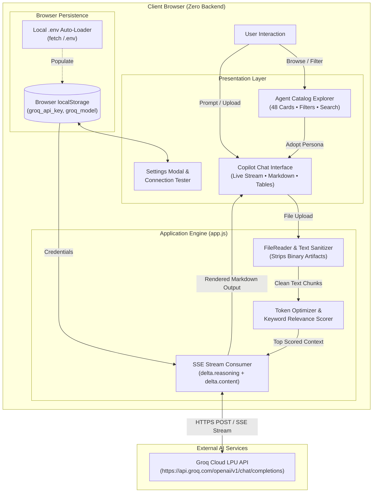

# 1. Project Title

# Copilot Agent Hub (48AGENTS)

> **Production-Grade Catalog of 48 Enterprise AI Copilots with In-Browser Document Grounding & Ultra-Fast Groq Streaming Reasoning.**

Enterprise teams frequently struggle to adopt generative AI because they lack standardized prompt engineering, structured persona definitions, and clear attachment guidelines across business functions. **Copilot Agent Hub** solves this by providing an interactive catalog of 48 battle-tested Copilot agent blueprints spanning 10 key departments. It empowers business users and engineers to explore personas, upload and ground models on enterprise documents, and run live real-time streaming inference via Groq LPUs with zero backend infrastructure.

[](https://github.com/shaikmuzamil1844-coder/48AGENTS)
[](LICENSE)
[](index.html)
[](https://groq.com/)
[](data.js)

---

# 2. Demo / Preview

- **GitHub Repository**: [https://github.com/shaikmuzamil1844-coder/48AGENTS](https://github.com/shaikmuzamil1844-coder/48AGENTS)
- **Live Demo Link**: [https://shaikmuzamil1844-coder.github.io/48AGENTS/](https://shaikmuzamil1844-coder.github.io/48AGENTS/) *(Deployable via GitHub Pages)*
- **Demo Video**: `[TODO: Add demo video link]`
- **Localhost Preview**: `http://localhost:3000`

```text
====================================================================================================
  [⚡ Copilot Agent Hub]   [All Domains (48)] [Executive] [Banking] ...      [🟢 Live AI: Connected]
====================================================================================================
  CATALOG EXPLORER                                  │ INTERACTIVE COPILOT CHAT
  [ 🔍 Search agents, prompts, personas... ]        │ Persona: Executive Briefing Agent (Tier 1)
  Filter by: [All Tiers ▼]  [All Complexities ▼]    │ ──────────────────────────────────────────────
                                                    │ 📎 Attached: Q3_Financial_Review.pdf (32 KB)
  ┌───────────────────────────────────────────────┐ │
  │ 📋 Executive Briefing Agent [Tier 1]          │ │ User: Prepare a 1-page executive brief
  │ Problem: Leadership needs rapid review context│ │
  │ Deliverable: Executive brief, key risks       │ │ Assistant:
  │ [ Adopt Persona ]  [ View Details ]  [ Copy ] │ │ 💭 Thinking: Evaluating revenue metrics...
  ├───────────────────────────────────────────────┤ │
  │ ⚠️ Decision Memo Agent [Tier 1]               │ │ 📋 1-Page Executive Briefing
  ├───────────────────────────────────────────────┤ │ • Top Wins: Revenue target met at 104%
  │ 🏃 Sprint Planning Agent [Tier 2]             │ │ • Key Blockers: EMEA onboarding latency
  └───────────────────────────────────────────────┘ │ [ Type prompt or query...            ] [ ➔ ]
====================================================================================================
```

---

# 3. Why This Project?

### Problem Being Solved
When enterprises attempt to roll out AI assistants, employees face the "blank prompt box" paralysis. Non-technical managers and domain specialists do not know how to instruct models to generate actionable deliverables, nor do they understand what background documents are necessary to ground the AI.

### Why the Problem Matters
Billions of dollars are lost in enterprise productivity because generic chatbot queries return superficial, hallucinated summaries that cannot be used in leadership reviews, sprint commitments, or compliance memos. Organizations spend months designing ad-hoc prompts without standards for personas, tiers, or inputs.

### Limitations of Existing Approaches
1. **Heavy Server Overhead**: Most custom agent tools require complex Docker containers, vector databases, and multi-tier server architectures just to serve prompt templates.
2. **Token Rate Limit Failures**: Uploading raw enterprise PDFs or multi-page spreadsheets directly into API payloads overflows token limits, causing rate-limit errors on free and standard tiers.
3. **Data Privacy Concerns**: Traditional SaaS agent aggregators store sensitive company notes and credentials on third-party cloud backends.

### How This Project Addresses the Problem
- **48 Pre-Engineered Blueprints**: Covers 10 business domains with concrete inputs, outputs, persona guidelines, and copy-pasteable prompt templates.
- **Client-Side Document Optimization**: Uses a smart in-browser relevance extraction algorithm that strips unprintable binary artifacts and passes only high-scoring paragraphs to the LLM, keeping requests strictly within token budgets.
- **100% Client-Side Privacy**: Runs completely inside the browser. API keys and uploaded documents never leave the client except directly to Groq's official API endpoint.

---

# 4. Key Features

### 1. 48 Curated Enterprise Agent Blueprints
- **What it does**: Provides complete domain profiles covering Executive Management, IT Services, Banking/BFSI, HR, Sales, Operations, Finance, Marketing, Logistics, and Education.
- **Why it is useful**: Eliminates prompt-engineering guesswork; users get production-grade prompts with designated target audiences and expected deliverable structures.

### 2. Live Real-Time Groq AI Streaming
- **What it does**: Connects directly to Groq Cloud via Server-Sent Events (SSE) using models like `openai/gpt-oss-120b`, `openai/gpt-oss-20b`, `qwen/qwen3.8-27b`, and `allam-2-7b`.
- **Why it is useful**: Delivers instant, low-latency responses while rendering reasoning tokens (`delta.reasoning`) as live `💭 Thinking: ...` previews before streaming the final markdown deliverable.

### 3. In-Browser Document Grounding & Token Budgeter
- **What it does**: Ingests `.pdf`, `.docx`, `.txt`, `.csv`, `.md`, and `.json` files entirely in-browser, sanitizes raw text, and computes query-to-chunk relevance scores to select the top 3,500 characters.
- **Why it is useful**: Enables true document-grounded AI analysis without requiring a server-side vector database, protecting users from token limit errors.

### 4. Dual-Mode Operation (Live AI + Offline Simulation)
- **What it does**: Automatically detects whether an API key is present. If connected, it runs live LLM reasoning; if disconnected, it operates in simulated mode producing structured deliverables based on catalog specs.
- **Why it is useful**: Allows instant offline exploration, testing, and demonstrations without demanding immediate API configuration.

### 5. Seamless Credential & Environment Auto-Loading
- **What it does**: Automatically reads `GROQ_API_KEY` and `GROQ_MODEL` from a local `.env` file on startup or securely via browser `localStorage`, complete with an in-modal **Test Key** validator.
- **Why it is useful**: Developers can start testing immediately without hardcoding secrets into source code or committing them to git.

### 6. Modern Glassmorphism Workspace
- **What it does**: Offers multi-filter search (by domain pill, priority tier, and prompt complexity), dark/light theme switching, and an expandable chat drawer (`.chat-wide`).
- **Why it is useful**: Built with pure CSS custom properties for fluid responsiveness, clean contrast, and zero external framework bloat.

---

# 5. System Architecture

The project employs a clean, decentralized client-to-API architecture:



### Architecture Highlights
- **User → Frontend**: User selects an agent blueprint and submits prompts or documents through the responsive glassmorphism UI.
- **Frontend → Document Processing**: Documents are read via client-side `FileReader`, stripped of binary PDF headers, and scored by keyword density against the user prompt.
- **Frontend → External API**: The browser dispatches an authenticated HTTPS payload directly to Groq Cloud's `/openai/v1/chat/completions` endpoint with `stream: true`.
- **External API → Output**: Tokens stream back via Server-Sent Events, where `delta.reasoning` renders a real-time thinking status and `delta.content` renders formatted Markdown.

---

# 6. How It Works

The complete step-by-step runtime workflow:

1. **User Selects an Agent Blueprint**: The user searches or filters by domain (e.g. *Banking / BFSI*) and tier (e.g. *Tier 1*), then clicks **"Adopt Persona"**.
2. **Frontend Configures Role State**: `app.js` sets the active agent, dynamically building system instructions with the agent's problem statement, target audience, and required deliverable schema.
3. **User Uploads Context Document (Optional)**: The user attaches a corporate file (`.pdf`, `.csv`, `.docx`). The client-side `FileReader` extracts raw text and strips non-printable byte artifacts.
4. **Token Budget Optimization**: The system splits text into 500-character segments, calculates query relevance scores, and injects up to 3,500 characters of high-relevance context into the system prompt.
5. **Frontend Sends Streaming Request**: The browser dispatches a `fetch()` call to `https://api.groq.com/openai/v1/chat/completions` using the saved `groqApiKey`.
6. **AI Model Performs Inference**: Groq's LPUs execute the model (`openai/gpt-oss-120b`), streaming tokens via Server-Sent Events (SSE).
7. **Frontend Decodes and Renders Output**:
   - `delta.reasoning` updates a dynamic `💭 Thinking: ...` bubble.
   - `delta.content` streams into the Markdown parser to render headers, tables, code blocks, and bullet points in real time.
8. **Result Presented to User**: The finalized, formatted business deliverable is displayed, ready for immediate review or copying.

---

# 7. Technology Stack

| Category | Technology | Purpose |
|---|---|---|
| **Frontend** | HTML5, Vanilla JavaScript (ES6+) | Single-page application UI, catalog interaction, and DOM updates |
| **Backend** | Client-Side Serverless Architecture | Direct browser-to-API communication with zero intermediate server requirement |
| **Database** | Browser Web Storage (`localStorage`) | Client-side persistence for API credentials, active model, and session settings |
| **AI/ML** | Groq Cloud LPU API (`openai/gpt-oss-120b`, `openai/gpt-oss-20b`, `qwen/qwen3.8-27b`) | High-speed real-time streaming LLM inference and reasoning execution |
| **Authentication** | Bearer Token Auth (Client-Managed API Key) | Direct authenticated HTTPS calls to Groq API using user-provided credentials |
| **Deployment** | GitHub Pages / Static Web Server (Python `http.server`, Node.js `serve`) | Zero-configuration static hosting and local development serving |
| **Dev Tools** | Git, OpenSSH, PowerShell, VS Code | Version control, tunnel forwarding, and local development |

---

# 8. Project Structure

```text
48AGENTS/
├── .env                  # Local environment file containing GROQ_API_KEY (git-ignored)
├── .env.example          # Safe configuration template for environment setup
├── .gitignore            # Git exclusion rules (.env, logs, OS caches)
├── README.md             # Comprehensive technical documentation & project guide
├── app.js                # Main application controller, SSE streamer, doc grounding, UI events
├── data.js               # Dataset of 48 production agent specifications & prompts
├── index.html            # Main single-page interface, header, catalog, and modals
└── style.css             # Design system tokens, glassmorphism components, responsive media queries
```

### File Breakdown
- **[`index.html`](index.html)**: Main HTML5 entrypoint containing the header, catalog explorer panel, interactive chat interface, and settings modal.
- **[`style.css`](style.css)**: Pure CSS3 styling containing custom property tokens, glassmorphism card effects, scrollbars, and responsive grid layouts.
- **[`app.js`](app.js)**: Core application logic handling catalog filtering, search, document upload sanitization, token budgeting, `.env` auto-loading, and Groq streaming.
- **[`data.js`](data.js)**: Full dataset containing 48 validated enterprise agent definitions across 10 functional business domains.
- **[`.env.example`](.env.example)**: Reference environment file template for configuring credentials without committing secrets.
